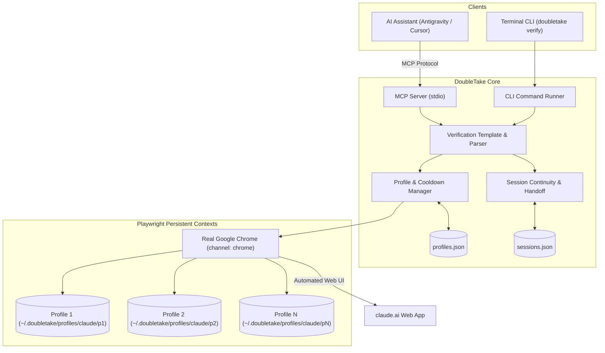

# DoubleTake 🌐🔍

<p align="center">
  
  
  
  
  
</p>

> **Automated, browser-driven cross-verification engine and Model Context Protocol (MCP) server.**  
> *"Always get a DoubleTake from Claude before you commit."*

---

## 🎯 What is DoubleTake?

**DoubleTake** connects your AI coding assistants (**Antigravity, Claude Code, Cursor, Windsurf**) and terminal workflows directly to web-based LLMs (starting with **Claude.ai**). It simulates real browser sessions across **multiple persistent profiles**, completely bypassing the need for paid API keys or enterprise subscriptions.

When an account hits free-tier message limits, DoubleTake **automatically detects the cooldown, records the reset time, and hot-rotates to the next available account**, preserving conversational context across the transition.

---

## ✨ Key Features

- 🔄 **Multi-Profile Hot-Rotation**: Seamlessly rotates between 2, 3, or more logged-in Chrome profiles when daily/hourly message limits are hit.
- ⏳ **Smart Cooldown Tracking**: Detects Claude's rate-limit banners, parses the exact reset time, records it in `~/.doubletake/profiles.json`, and skips exhausted profiles until their cooldown expires.
- 🤝 **Session Continuity & Context Handoff**: Keeps the chain with your active conversation. When rotating to a new account, DoubleTake automatically injects a concise **Context Handoff Header** detailing prior turn summaries, verdicts, and findings so the new account has instant situational awareness without token bloat.
- 🛡️ **Anti-Detection Stealth Engine**: Drives your installed Google Chrome (`channel: 'chrome'`) with custom anti-automation flags (`--disable-blink-features=AutomationControlled`), reliably passing Cloudflare Turnstile bot challenges.
- 💻 **Agent-Friendly & Copyable Outputs**: Prompts Claude to provide exact, isolated ```bash command blocks and drop-in code patches, automatically parsing them into a structured `copyable_commands` array for autonomous agent execution.
- 📋 **Built-In Review Modes**:
  - `code-review`: Deep architectural review, code hygiene, and edge case coverage.
  - `bug-check`: Targeted analysis for null dereferences, unhandled async promises, race conditions, and memory leaks.
  - `security-audit`: OWASP, injection, credential leaks, and auth bypass checks.
  - `general-verification`: Requirement conformance and regression checks.
  - `custom`: Raw user prompts.
- 🔌 **Dual Invocation**: Seamlessly usable either via **MCP** inside your AI editor or via global **CLI** in your terminal.

---

## 🏗️ Architecture



---

## 🚀 Quick Start

### 1. Installation

Clone and install dependencies:

```bash
cd doubletake
npm install

# Link globally so you can run 'doubletake' from any terminal
npm link
```

### 2. Authenticate Your Profiles (One-Time Setup)

Run the interactive `login` command for each Claude account you want to use in your rotation pool:

```bash
# Log into your primary profile
doubletake login --profile=profile-1 --label="Primary Account"

# Log into your backup profile (for automated rate-limit failover)
doubletake login --profile=profile-2 --label="Backup Account"
```

1. A real Google Chrome window opens to `https://claude.ai`.
2. Sign in with your Google account or email and complete any 2FA.
3. Return to the terminal and press **ENTER**.
4. The session cookies and storage state are permanently cached in `~/.doubletake/profiles/claude/<profile-id>`.

---

## 💻 CLI Usage

### Check Profile Status & Cooldown Timers

```bash
doubletake status
```

**Example Output:**
```text
======================================================
 🌐 DoubleTake Profiles Status [CLAUDE]
======================================================

✅ ID: profile-1 (Primary Account)
   Status:       READY
   Last Used:    11/13/2026, 9:15:00 AM

⏳ ID: profile-2 (Backup Account)
   Status:       RATE_LIMITED
   Cooldown:     Rate limited until 1:00:00 PM (~145 mins left)
   Last Used:    11/13/2026, 9:00:00 AM
======================================================
```

### Run Autonomous Verification

```bash
# 1. Verify code changes for security vulnerabilities
doubletake verify "Review this auth middleware for token leakage and replay attacks" \
  --mode=security-audit \
  --files=src/auth.js

# 2. Verify a git diff directly from git
git diff HEAD~1 | doubletake verify "Check this patch for concurrency bugs" \
  --mode=bug-check \
  --diff=-

# 3. Watch the browser in visible head mode
doubletake verify "Check this algorithm" --show-browser
```

### Maintain Conversation Continuity Across Turns

Pass `--session <id>` to chain multiple verification rounds. DoubleTake re-uses the exact same Claude chat thread on the active account, or automatically injects a handoff summary if it has to switch to a backup account:

```bash
# Turn 1
doubletake verify "Audit authentication handler" \
  --mode=security-audit \
  --files=src/auth.js \
  --session=my-feature-chain

# Turn 2 (Testing the fix for previous turn)
doubletake verify "Check if the token validation fix resolves the prior issue" \
  --mode=security-audit \
  --files=src/auth.js \
  --session=my-feature-chain
```

### Profile Management

```bash
# List all configured profiles
doubletake profiles

# Remove a profile from active rotation
doubletake profiles --remove profile-3

# Remove a profile AND purge its stored browser data/cookies from disk
doubletake profiles --remove profile-3 --delete-data

# Inspect an active session in a visible Chrome window
doubletake open --profile=profile-1
```

---

## 🔌 MCP Server Setup (Antigravity, Cursor, Claude Code)

Add DoubleTake to your MCP configuration file (e.g. `~/.gemini/antigravity/mcp_config.json` or editor settings):

```json
{
  "mcpServers": {
    "doubletake": {
      "command": "node",
      "args": [
        "/absolute/path/to/doubletake/bin/mcp-server.mjs"
      ]
    }
  }
}
```

### Available MCP Tools

| Tool Name | Parameters | Description |
| :--- | :--- | :--- |
| `doubletake` (alias `doubletake_verify`) | `prompt`, `mode`, `files`, `diff`, `session_id`, `profile`, `wait_if_rate_limited` | Submits code/diff for independent review by Claude.ai across rotating profiles. Seamlessly maintains conversation chains across profiles using `session_id`. Returns structured verdict (`PASS`, `FAIL`, `WARNINGS`), summary, and copyable commands. |
| `doubletake_status` (alias `verifier_status`) | `provider` | Reports availability, active profile, and cooldown timers across all accounts. |
| `add_profile` | `profile_id`, `label`, `provider` | Registers a new profile for browser automation. |
| `remove_profile` | `profile_id`, `delete_data`, `provider` | Unregisters a profile and optionally deletes its cached browser storage on disk. |

---

## 🔒 Security & Privacy

- **100% Local**: No external proxy, no intermediate cloud server, no telemetry.
- **Direct Connection**: Traffic goes strictly between your local Google Chrome process and `claude.ai` over official HTTPS.
- **Your Data Stays Yours**: Profiles and credentials remain on your local machine under `~/.doubletake/`.

---

## 📄 License

MIT License. Free for personal and commercial use.
